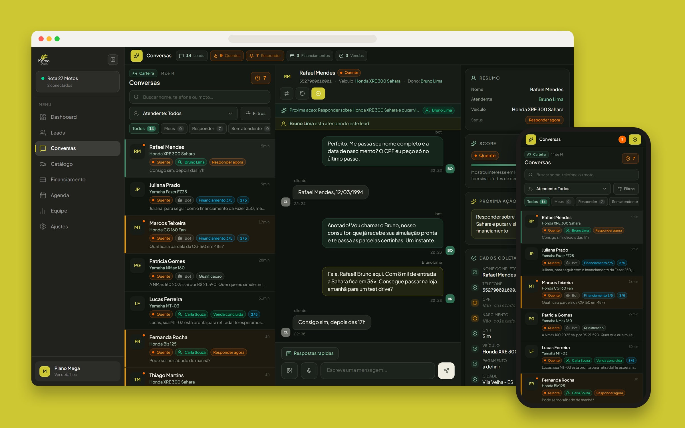
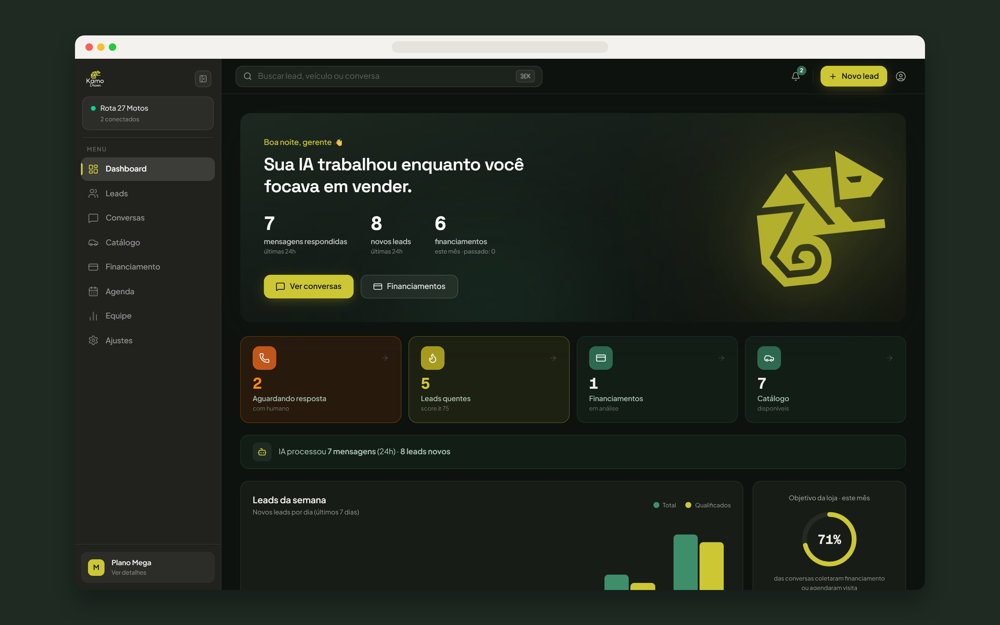
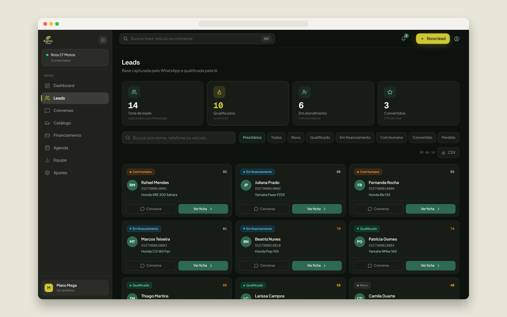
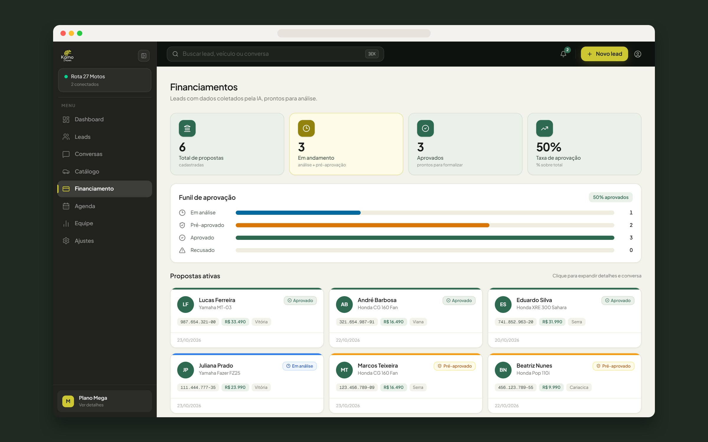
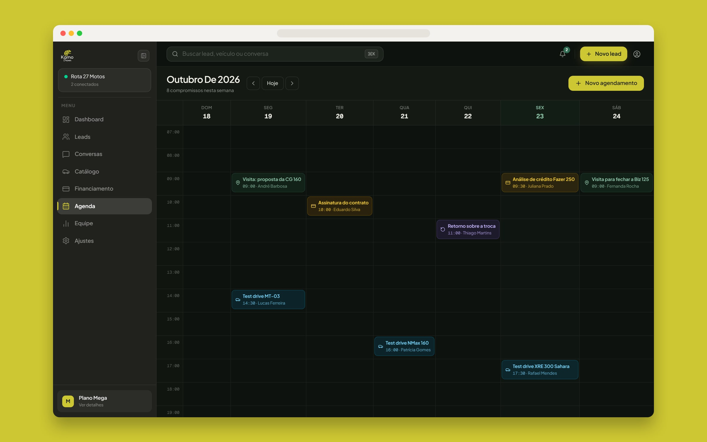
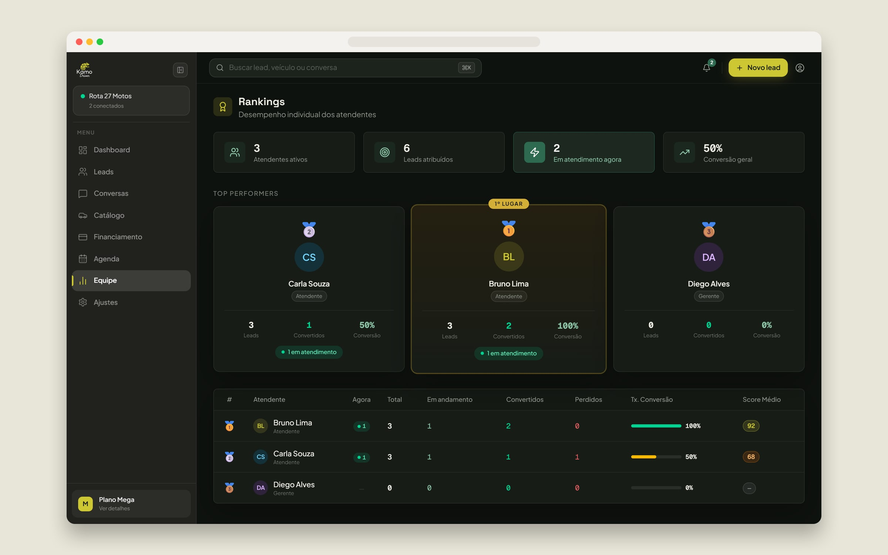
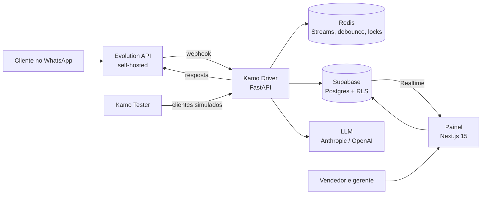

# Kamo: IA que atende o WhatsApp da concessionária e entrega o cliente pronto para o vendedor

Toda revenda de veículos tem o mesmo gargalo. O WhatsApp da loja recebe dezenas de mensagens por dia, o vendedor demora para responder, e o lead que perguntou o preço às 23h compra em outro lugar. O Kamo é o SaaS que eu construí e opero sozinho para resolver isso. A IA responde em segundos, qualifica o interesse, conduz o financiamento passo a passo e passa a conversa para o vendedor no momento certo, com o histórico pronto. O gerente acompanha tudo num painel em tempo real.

Está no ar em [driver.kamo.ia.br](https://driver.kamo.ia.br), com cliente pagante.

> Repositório vitrine. O código do Kamo é privado. Os prints foram tirados do painel rodando na minha máquina contra um banco de mentira: a loja "Rota 27 Motos", as pessoas, os telefones e os CPFs não existem.

## Em produção

Números do banco de produção, do dia em que a primeira loja entrou (15/05/2026) até 17/08/2026:

| | |
|---|---|
| Clientes atendidos pelo WhatsApp | 1.602 |
| Mensagens trocadas | 30.772 |
| Mensagens que chegaram com a loja fechada | 2.733 (23,3% das recebidas) |

Quase um quarto das mensagens chega fora do horário. Sem a IA, essas pessoas esperariam a loja abrir.

## O painel

O dashboard abre com o que a IA fez enquanto o time estava vendendo: mensagens respondidas, leads novos e financiamentos coletados, mais o que precisa de alguém agora.

Cada lead ganha uma nota de 0 a 100 conforme a conversa avança. A lista abre pelos prioritários, e o filtro por estágio mostra quem é novo, quem está qualificado, quem está no financiamento e quem já fechou.

| Financiamento | Agenda |
|---|---|
|  |  |

A IA coleta nome, CPF, nascimento, CNH e veículo dentro da conversa, uma pergunta por vez, e a ficha cai pronta no funil de aprovação. Test drive, visita e assinatura de contrato entram na agenda do vendedor certo.

O ranking mostra quem atendeu, quem converteu e quem está perdendo cliente, com a taxa de conversão e a nota média de cada vendedor.

## Arquitetura

São três aplicações. O **Driver** recebe os webhooks do WhatsApp, decide a resposta e envia. O **painel** é onde a loja trabalha. O **Tester** conversa com o bot de verdade, fingindo ser cliente em cenários como comprador decidido, CPF digitado errado e pedido de humano, e outra IA dá nota para cada conversa. Tudo roda em Docker Swarm atrás do Traefik, numa VPS que eu mantenho.

Uma mensagem passa por isto:

1. A Evolution API entrega o webhook. O Driver valida, descobre de qual loja é e grava o evento num Redis Stream. O webhook responde na hora e o trabalho segue num worker.
2. O worker descarta grupo, mensagem da própria loja, duplicata e eco do bot. Áudio vira texto.
3. Gente digita do jeito que fala: uma pergunta chega em quatro mensagens em três segundos. Um debounce junta tudo numa unidade só, e um lock por loja e telefone impede duas respostas para a mesma pessoa.
4. O lead é criado ou recuperado, a IA decide a resposta, e ela sai dividida em mensagens curtas, como uma pessoa escreveria.
5. Nota, resumo e métricas são atualizados, e o painel recebe a mudança pelo Supabase Realtime, sem recarregar.

O isolamento entre lojas é por `tenant_id` em todas as tabelas, com Row Level Security no painel. O dono vê tudo. O gerente vê a loja inteira. O atendente vê só os números de WhatsApp que são dele.

## O que o Kamo me ensinou, em código aberto

Os problemas mais chatos que o Kamo encontrou viraram bibliotecas públicas:

- **[burstq](https://github.com/Dowgg18/debounced-webhook-pipeline):** o passo 3 acima, isolado. Transforma uma rajada de webhooks numa unidade de trabalho ordenada por conversa e sobrevive a um crash no meio.
- **[replaygate](https://github.com/Dowgg18/agent-replay-gate):** a ideia do Tester levada ao CI. Repete conversas gravadas com todo I/O lacrado e quebra o build quando um caminho que deveria ser determinístico chama o modelo.
- **[proven](https://github.com/Dowgg18/unhealthy-until-proven):** nasceu de um painel que mostrou um WhatsApp como "Conectado" por dois meses depois de ele cair. Um health check tem três resultados, não dois.
- **[reachable](https://github.com/Dowgg18/covered-but-unreachable):** acha o código que os testes executam e que nenhum cliente consegue alcançar.

## Stack

Python · FastAPI · asyncio · Redis Streams · Supabase (Postgres, Auth, Realtime, RLS) · Next.js 15 · React 19 · TypeScript · Tailwind · Zustand · Evolution API · Anthropic SDK · OpenAI SDK · Asaas · Docker Swarm · Traefik

## Outros cases

- [E-commerce da 4Life Nutrition](https://github.com/Dowgg18/4life-nutrition-showcase): loja com código próprio, do checkout à nota fiscal.
- [Creator Army da 4Life](https://github.com/Dowgg18/4life-creators-showcase): programa de influenciadores com cupom e comissão apurada sozinha.
- [Câmara Brasil-Rússia](https://github.com/Dowgg18/camara-brasil-russia-showcase): portal em português, russo e inglês com redação assistida por IA.

---

Douglas Domingos · [github.com/Dowgg18](https://github.com/Dowgg18) · [LinkedIn](https://www.linkedin.com/in/douglas-c-domingos/)
